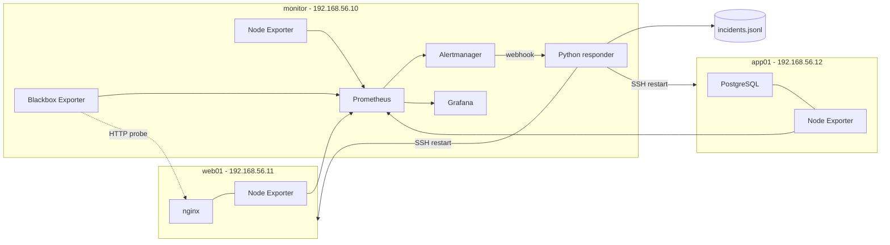
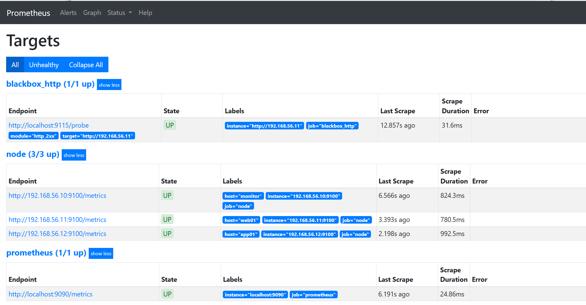
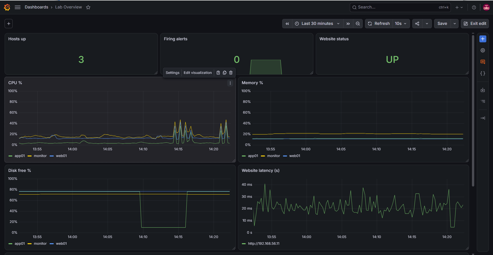
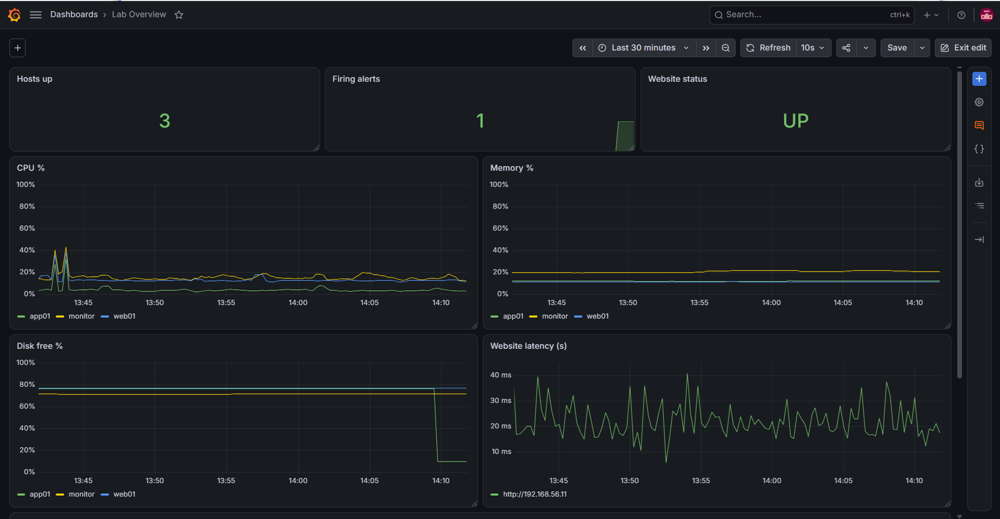
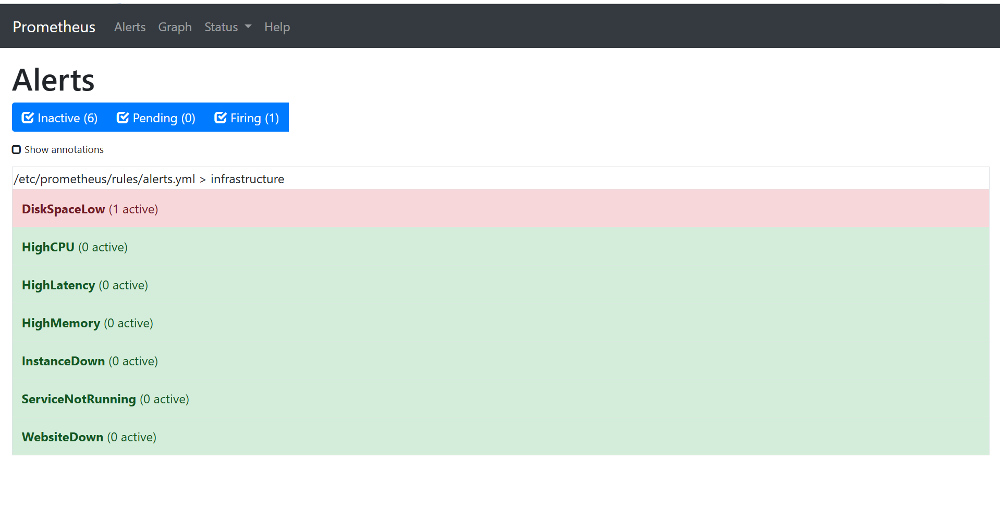
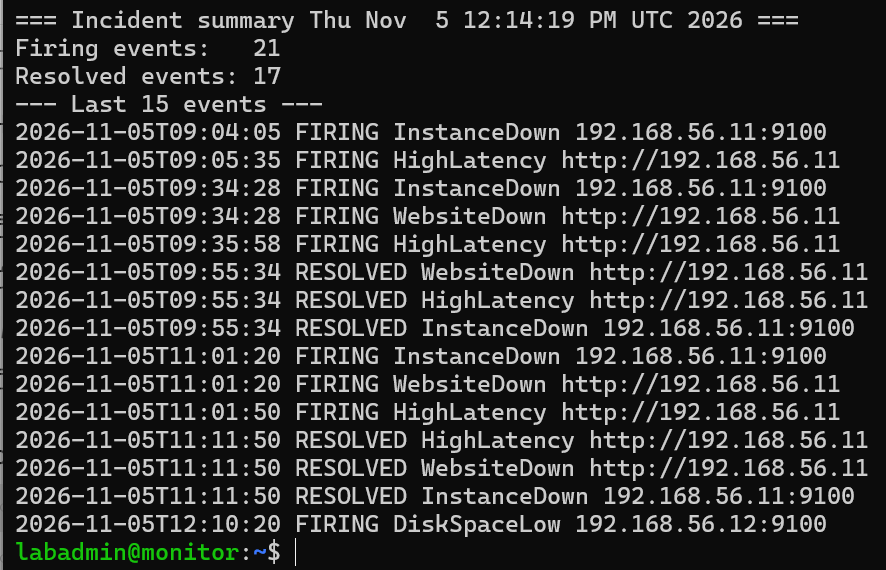

# Infrastructure Monitoring & Incident Response Lab

A virtual IT environment that monitors Linux servers, detects failures, raises alerts and automatically recovers from common incidents. Built with Prometheus, Grafana, Alertmanager and custom Python/Bash automation on VirtualBox.

## Key results

- **3 VMs** monitored: CPU, memory, disk, network, systemd services and website availability
- **7 alert rules**, and every one was triggered and verified with a deliberate failure
- **7 distinct failure scenarios** injected and detected by the monitoring
- **Automatic remediation** restarted stopped services (nginx, PostgreSQL) with alerts clearing in 24-35 seconds and no human action
- **Every incident logged** as structured JSON for review and reporting

## Architecture



| VM | Role | IP |
|----|------|----|
| monitor | Prometheus, Grafana, Alertmanager, Blackbox Exporter, Python responder | 192.168.56.10 |
| web01 | nginx web server + Node Exporter | 192.168.56.11 |
| app01 | PostgreSQL + Node Exporter | 192.168.56.12 |

**Environment:** VirtualBox, Ubuntu Server 24.04.5 LTS, each VM with 4 vCPUs, 4 GB RAM and 25 GB disk, and two network adapters (NAT for internet, host-only `192.168.56.0/24` for the lab network).

## Tech stack

Prometheus - Node Exporter - Blackbox Exporter - Alertmanager - Grafana - Python 3 - Bash - systemd - SSH key authentication - sudoers

## How it works

1. **Collect:** Node Exporter exposes CPU, memory, disk, network and systemd service metrics on every host. The Blackbox Exporter probes the website over HTTP.
2. **Detect:** Prometheus scrapes every 15 seconds and evaluates the alert rules.
3. **Alert:** Alertmanager groups alerts and sends firing and resolved notifications to a webhook.
4. **Respond:** A Python responder logs each incident as a JSON line and, for a stopped service, restarts it over SSH.
5. **Visualise:** Grafana shows the live state of the environment on the Lab Overview dashboard.

## Alert rules

| Alert | Condition | For | Severity |
|-------|-----------|-----|----------|
| InstanceDown | Host stops answering scrapes | 30 s | Critical |
| WebsiteDown | HTTP probe fails | 30 s | Critical |
| ServiceNotRunning | nginx or PostgreSQL systemd unit inactive | 20 s | Critical |
| HighCPU | CPU above 80% | 1 min | Warning |
| HighMemory | Memory above 70% | 1 min | Warning |
| DiskSpaceLow | Less than 20% disk free | 30 s | Critical |
| HighLatency | HTTP response above 1 s | 1 min | Warning |

Full definitions: [prometheus/rules/alerts.yml](prometheus/rules/alerts.yml). Each alert has a runbook in [runbooks/](runbooks/).

## Failure tests

Failures were injected with [automation/chaos.sh](automation/chaos.sh) (or directly in VirtualBox). "Alert duration" is the time from the alert firing to resolving, taken from the incident log (UTC; Cape Town is UTC+2).

| Failure | Method | Alert fired | Alert duration | Outcome |
|---------|--------|-------------|----------------|---------|
| nginx stopped (web01) | `chaos.sh service` | ServiceNotRunning, WebsiteDown | 35 s | Auto-restarted by responder |
| PostgreSQL stopped (app01), run 1 | `chaos.sh db` | ServiceNotRunning | 25 s | Auto-restarted by responder |
| PostgreSQL stopped (app01), run 2 | `chaos.sh db` | ServiceNotRunning | 24 s | Auto-restarted by responder |
| Disk filled to about 90% (app01) | `chaos.sh disk` | DiskSpaceLow | 95 s | Diagnosed with `df` and `du`, fixed manually |
| Network latency added (web01) | `chaos.sh network` | HighLatency | 65 s | Cleared automatically after the test |
| VM powered off (app01) | VirtualBox | InstanceDown | 95 s | VM restarted |
| CPU stress (web01) | `chaos.sh cpu` | HighCPU | 80 s | Cleared when the test ended |
| Memory stress at 80% of RAM (web01) | `chaos.sh memory` | HighMemory, fired 14:23:33 UTC | [DURATION] | Cleared when the test ended |

Raw data: [docs/sample-incidents.jsonl](docs/sample-incidents.jsonl). The log also contains a few web01 outages on 5 Nov that were not planned tests, which the monitoring detected on its own.

## Screenshots

| | |
|---|---|
|  |  |
| Prometheus targets | Lab Overview dashboard |
|  |  |
| Failure visible on the dashboard | Alert firing in Prometheus |



*Incident summary generated by `incident_report.sh`.*

## Key findings

- **Automated remediation worked.** Stopped services were detected and restarted, with the alert clearing in under 40 seconds and every action logged.
- **A silent alert is not a working alert.** The `HighMemory` rule did not fire in my first tests. Measuring memory live showed the test loads peaked at 28% and 67%, below the 70% threshold, and the rule file on the monitor still held the old 85% value. After fixing both, it fired. See the [postmortem](docs/postmortems/2026-11-05-memory-alert-tuning.md).
- **Two independent checks beat one.** When nginx stopped, both the systemd collector (`ServiceNotRunning`) and the HTTP probe (`WebsiteDown`) fired, so a service that is running but not serving would still be caught.
- **Least privilege.** The responder can only run `systemctl restart nginx` and `systemctl restart postgresql` on the targets, enforced by sudoers rules.

## Repository structure

```
monitoring-lab/
├── alertmanager/     Alertmanager configuration
├── automation/       Python responder, systemd unit, chaos and report scripts
├── docs/
│   ├── postmortems/  Incident write-ups
│   ├── screenshots/  Dashboard and alert evidence
│   └── sample-incidents.jsonl
├── grafana/          Lab Overview dashboard (importable JSON)
├── prometheus/       Prometheus and Blackbox configuration, alert rules
└── runbooks/         One runbook per alert
```

## Setup

1. **VMs:** create three Ubuntu Server 24.04 VMs in VirtualBox (NAT + host-only adapters). Assign static IPs `192.168.56.10`, `.11` and `.12` with netplan.
2. **Targets (web01, app01):**
   ```bash
   sudo apt install -y prometheus-node-exporter stress-ng
   echo 'ARGS="--collector.systemd --collector.processes"' | sudo tee /etc/default/prometheus-node-exporter
   sudo systemctl restart prometheus-node-exporter
   ```
   Install `nginx` on web01 and `postgresql` on app01.
3. **Monitor:**
   ```bash
   sudo apt install -y prometheus prometheus-node-exporter prometheus-alertmanager prometheus-blackbox-exporter
   ```
   Install Grafana from the official apt repository.
4. **Configuration:** copy `prometheus/prometheus.yml` and `prometheus/blackbox.yml` to `/etc/prometheus/`, `prometheus/rules/alerts.yml` to `/etc/prometheus/rules/`, and `alertmanager/alertmanager.yml` to `/etc/prometheus/`. Restart the services.
5. **Responder:** copy `automation/responder.py` to `/opt/responder/`, install `responder.service` in `/etc/systemd/system/`, create an SSH key on the monitor, and add the sudoers restart rules on the targets.
6. **Dashboard:** in Grafana, go to Dashboards, New, Import and upload `grafana/lab-overview.json`.

## Skills demonstrated

Linux administration - virtualisation and networking - infrastructure monitoring - alert design - incident response - Bash and Python automation - systemd - SSH and least-privilege access control - troubleshooting - documentation (runbooks, postmortems)

## Limitations and future improvements

- Alerts go to a local webhook only. Next: Telegram or email notifications.
- Harden the hosts with a firewall (UFW), SSH key-only login and fail2ban.
- Add Ansible playbooks to deploy the whole stack automatically.
- Add Loki and Promtail for log monitoring alongside metrics.
- Add a disk-cleanup action to the responder for `DiskSpaceLow`.

## What I learned

Building this lab showed me how a failure travels from a metric, to an alert, to an automatic action, and how each step can fail silently. My memory alert didn't fire at first, and I had to measure the real usage and check the loaded rule instead of assuming my configuration was applied. I also learned to size stress tests against the actual VM resources. Writing runbooks and postmortems taught me to document what really happened, including my own mistakes, rather than a tidy story. Next time I would deploy the whole stack with Ansible so it could be rebuilt in minutes.

## Author

**Eugine Tshisimba** - Computer Engineering student, Cape Peninsula University of Technology
[LinkedIn](https://www.linkedin.com/in/eugine-tshisimba/) - [GitHub](https://github.com/euginerams)